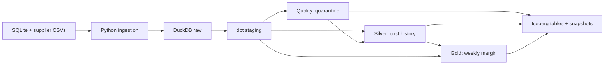

# Qafila gross margin

Submitted by: **Moayad Alshehri** — academy: **@SDAIAAcademy · SDAIA Academy (Sidai Academy)**

Qafila's sales database records revenue, while supplier costs arrive in messy
weekly CSV files. This project combines both sources into a weekly gross margin
table, applies each product's cost as it stood on the order date, and retains the
previous results when a supplier sends a late correction.

The assignment and output contract are in [BRIEF.md](BRIEF.md).
Source projects and reused components are listed in [ACKNOWLEDGEMENTS.md](ACKNOWLEDGEMENTS.md).

## Run the project

Requires Python 3.10–3.13 and [uv](https://docs.astral.sh/uv/getting-started/installation/).
Run these commands from the folder containing `pyproject.toml`:

```bash
git clone https://github.com/Moashehri/qafila-margin-project.git
cd qafila-margin-project
uv sync --frozen
uv run python tools/make_data.py
uv run python run.py
uv run python tools/check.py
uv run python tools/reference_check.py
```

Windows users can also double-click `RUN_ON_WINDOWS.bat` after installing uv.
The script stops if a command fails.

```bash
uv run python tools/show_tables.py    # published rows, snapshots and historical totals
uv run python tools/spot_check.py     # follow a product and order line through the pipeline
```

The two PDF guides are in [output/pdf](output/pdf).

## Pipeline and table grain



| Layer / model | One row per | Stored as |
|---|---|---|
| `raw.orders`, `order_items`, `products`, `stores` | Original application row | DuckDB table |
| `raw.supplier_prices` | Supplier CSV row, with `source_file` and `file_row` | DuckDB table |
| `stg_orders`, `stg_order_items` | Order / order line | dbt view |
| `stg_products`, `stg_stores` | Product / store | dbt view |
| `stg_supplier_prices` | Supplier CSV row, with parsed cost and date | dbt view |
| `quality.price_quarantine` | Rejected supplier row | dbt table + Iceberg |
| `silver.product_cost_history` | SKU and cost version | dbt table + Iceberg |
| `gold.weekly_margin` | ISO week, city and category | dbt table + Iceberg |

Raw tables are rebuilt from the current inputs on each run. Supplier columns are
combined by name, so `unit_cost`, `cost_sar`, and additional columns survive schema
changes. SQLite is read with Python's built-in `sqlite3`; no DuckDB SQLite
extension download is needed.

## Cost history and margin rules

Staging trims SKUs, normalizes Arabic-Indic digits and decimal commas, and uses
`try_cast` to parse costs. The original cost text is retained for rejected rows.
Unknown SKUs receive `unknown_sku`; known SKUs with missing, non-finite, zero or
negative costs receive `invalid_cost`. Rejected rows cannot enter cost history.

For accepted quotes with the same SKU and effective date, the filename that sorts
last wins. A correction file therefore replaces the earlier quote without a
special case in the SQL. `lag` identifies actual cost changes; `lead` supplies the
exclusive end date of each version. A product omitted from a weekly file keeps
its previous cost, and an unchanged quote creates no new version.

Order timestamps are converted from UTC to Riyadh time before selecting the order
date and ISO week. Counted lines have delivered orders, positive quantities and
an order date on or after 2026-08-31. Each line joins the cost version satisfying
`valid_from <= order_date < valid_to`, with an open end for the current version.

Revenue is rounded per line: `round(quantity * unit_price - discount, 2)`.
A line without a valid cost remains in total lines and revenue, and is counted
in `uncosted_lines`. Gross margin is `costed_revenue_sar - cost_sar`.

## Data issues

These counts refer to the generated seed 2026 dataset before its correction.

| Issue | Count | Handling |
|---|---:|---|
| Decimal-comma costs in W38 | 126 rows | Normalize the decimal separator |
| Arabic-Indic costs in W38 | 34 rows | Translate digits and separator |
| UTF-8 byte-order mark | 1 file | Read with `utf-8-sig` |
| Renamed cost column in W39 | 160 rows | Keep both column names in raw |
| Zero or negative supplier costs | 4 rows | Quarantine as `invalid_cost` |
| Unknown supplier SKUs | 3 rows | Quarantine as `unknown_sku` |
| Trailing spaces in product SKUs | 2 products | Trim before comparing SKUs |
| Non-positive quantities | 142 lines | Exclude from counted lines |
| Non-delivered orders | 5,347 orders | Exclude from counted lines |
| Counted lines without a cost version | 20,626 of 82,404 | Keep revenue; flag as uncosted |
| Late correction | 9 supplier rows | Rebuild affected versions and margin |

## Verification

Every pipeline run executes **26 dbt tests**. They cover key uniqueness and nulls,
allowed quarantine reasons, valid SKU relationships, one current version per SKU,
continuous version intervals, cost changes, margin arithmetic, and complete
coverage of eligible order lines. There are 34 total dbt build nodes: 8 models
and 26 tests.

`tools/check.py` checks the output contract. `tools/reference_check.py` separately
recomputes all three outputs from SQLite and CSV in Python, without using the dbt
SQL, and compares them with the published Iceberg tables.

The full verification exercises seeds 2026 and 11 in temporary folders:

```bash
uv run python tools/verify_pipeline.py --report docs/verification.json
```

For each seed it checks initial results, re-runs before and after a correction,
stable table identities, snapshot counts, and reads of every pre-correction
snapshot. The measured results and snapshot IDs are in
[docs/verification.json](docs/verification.json).
See [docs/VALIDATION.md](docs/VALIDATION.md) for the readable results.

## Re-runs and supplier corrections

```bash
uv run python run.py
uv run python tools/make_data.py --add-correction
uv run python run.py
uv run python tools/reference_check.py
uv run python tools/show_tables.py
```

Publishing compares rows regardless of order. Identical rows produce no new
snapshot. Changed rows replace the old contents in one overwrite commit of the
same Iceberg table, so its previous snapshot remains readable. The quarantine
still contains the original bad rows after a correction, because those rows
remain in the original supplier file.

To try another dataset without changing the default one:

```bash
uv run python tools/make_data.py --seed 11 --out data_11
uv run python run.py --data-dir data_11 --warehouse warehouse_11
uv run python tools/check.py --data-dir data_11 --warehouse warehouse_11
uv run python tools/reference_check.py --data-dir data_11 --warehouse warehouse_11
```

## Troubleshooting

| Message | Action |
|---|---|
| `uv` is not recognized | Install uv and reopen the terminal |
| `No pyproject.toml found` | Change into the cloned repository folder |
| `qafila_oltp.sqlite not found` | Generate data before running the pipeline |
| `dbt build failed` | Read the failing model or test above that message |
| DuckDB file is locked | Close other connections to the same warehouse |

Generated datasets, warehouses, environments and dbt build artifacts are ignored
by Git. Keep the warehouse if historical snapshots are needed.

## Scaling considerations

The full source reload and full-table comparison suit this course dataset. At
larger volumes, ingest only new or updated source records, track received files,
and recompute the weeks touched by a new cost or correction. Partitioning margin
data by week would limit rewrites. Daily price feeds would also benefit from an
explicit receipt timestamp instead of filename order for correction precedence.
